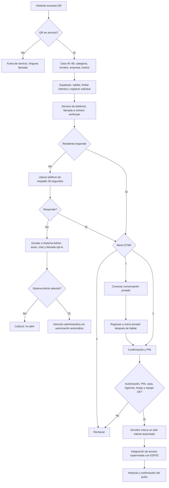

# Diseño: Interfón telefónico inteligente para repartidores, proveedores, técnicos y visitas

Estado: **DISEÑO; no activado en producción**. Infraestructura existente: GitHub Pages (`repartidor.html`, `index.html`), Supabase y ESP32. Esta especificación no habilita llamadas ni abre el portón.

## Objetivo
Desde el QR existente del Portero Virtual, una persona selecciona casa 40–66 y categoría (repartidor, proveedor, técnico/mantenimiento, visita particular u otro), declara nombre, empresa o Particular, motivo y pulsa **📞 Llamar al residente**. El sitio indica «Conectando con el residente…» y llama al número móvil o fijo privado verificado de la casa.

El residente atiende una llamada ordinaria, sin necesitar internet. Dos opciones:
- **1 Hablar con el visitante**: conversación bidireccional mediante navegador/micrófono del visitante y servicio de telefonía. La llamada del residente debe entrar en menú privado al terminar la conversación (no recoger clave mientras el visitante escucha).
- **2 Autorizar sin conversar**: el sistema solicita PIN secreto personal y confirma intención. Solo una llamada/solicitud validada y autorizada puede crear como máximo una orden de apertura de portón, tras todos los controles físicos y de servidor.
- **3 Rechazar**: marcar rechazo y notificar al visitante. Si ninguno de los teléfonos responde, aplicar la escalación obligatoria a Sistema Admin descrita abajo; no abrir el portón.

Los textos dirán «Empresa declarada: X», no «Empresa verificada», hasta existir una verificación real.

## Escalación obligatoria cuando no contesten los teléfonos

**Decisión confirmada de Administración:** si el residente no contesta los teléfonos configurados, **contactar a Sistema Admin**. Esta política se aplica por igual a repartidores, proveedores, técnicos/mantenimiento y visitas. No supone una autorización de apertura. La telefonía sigue sin estar instalada.

Secuencia de llamada con tiempos **propuestos y configurables**:
1. Llamar al **teléfono principal verificado** de la casa durante hasta **30 segundos**. Si el residente contesta y atiende, no escalar; si rechaza explícitamente, cerrar como rechazado.
2. Si el primer teléfono no responde, está ocupado o falla, llamar al **segundo teléfono verificado** durante hasta **30 segundos**. Si la casa no tiene segundo teléfono, avanzar inmediatamente al siguiente paso.
3. Si tampoco responde, o si no existen teléfonos verificados, marcar la solicitud como **sin_respuesta_residente** y **escalar una sola vez** a Sistema Admin; generar aviso prioritario y un chat especial ligado a la misma solicitud.
4. Sistema Admin podrá recibir también una **llamada a su propio número verificado**, si ha activado esa preferencia de atención y hay servicio telefónico operativo. En la plataforma verá casa de destino, tipo de visitante, empresa *declarada*, nombre, motivo y resultado de las llamadas; jamás el teléfono privado del residente.
5. En el QR mostrar: **«No fue posible contactar al residente. Conectando con Administración…»**. Si Sistema Admin no puede atender antes de la caducidad de la solicitud, mostrar **«No fue posible completar la atención»**, cerrar la sesión y mantener el portón cerrado.

**Condición de escalación:** el proveedor de telefonía debe enviar callbacks autenticados que acrediten el fin de ambos intentos o confirmar que no había un destino válido. No basta con un temporizador del navegador ni con una afirmación del visitante. Los estados `no-answer`, `busy` y `failed` pueden justificar el siguiente intento. Si `completed` significa que contestó un buzón de voz o un contestador, **no considerarlo autorización**: confirmar interacción humana válida en el menú para dar por atendida la llamada.

**Antiduplicados:** asociar los intentos a la misma solicitud y guardar el progreso transaccionalmente (`principal_pendiente` → `respaldo_pendiente` → `escalado_admin` → `atendido` / `vencido` / `rechazado`). Identificadores de llamada únicos, webhooks firmados, protección ante reintentos y límite **una escalación activa por solicitud**. Si alguien responde o rechaza mientras se está preparando la siguiente etapa, cancelar la llamada o el escalado pendientes y no volver a notificar.

**Integración existente:** reutilizar `portero_owner_chats` y `access_private.notify_owners` para comunicar la solicitud a Sistema Admin. El flujo de escalación del Portero IA existente está basado en **2 minutos** y una solicitud `portero_modo_mixto` vigente; la telefonía debe introducir una ruta autenticada propia para el caso «ambos teléfonos sin respuesta» en lugar de simular que transcurrieron esos 2 minutos, falsificar datos o elevar privilegios. Toda autorización por Sistema Admin debe pasar por las verificaciones del servidor y del equipo.

**Fuera de servicio:** si el QR se desactiva antes o durante la cadena, detener nuevas llamadas y escalaciones y bloquear autorizaciones posteriores. Si Sistema Admin tampoco responde, no abrir ni iniciar una orden física. Las llamadas de emergencia no dependen de este módulo.

## Arquitectura propuesta

### Frontend

- `repartidor.html`: conservar QR y flujo vigente, ofrecer opción «Llamar al residente» y categorías; mostrar «Conectando…», «Llamando al segundo número…», «Conectando con Administración…», «En conversación», «Autorizado», «Rechazado», «Sin respuesta», «Fuera de servicio» según eventos del servidor; botón cancelar. Micrófono con consentimiento explícito y HTTPS para hablar; si no hay permiso de micrófono, no activar modo conversación.
- `index.html`: «Teléfono del interfón» para el residente con opt-in, móvil o fijo, preferencia, horario, prueba de número, PIN y revocación. No mostrar números a visitantes ni terceros. Administración solo ve estado de contacto verificado, no el teléfono en claro salvo funciones estrictamente necesarias. Registrar resultados en historial de accesos.

### Supabase (nuevas tablas privadas)

- `interfon_contactos`: casa_id, residente_id, número E.164 cifrado, tipo móvil/fijo, principal/respaldo, verificado_at, consentimiento_at, horario, activo. Solo residente autorizado de su casa puede gestionar contactos; los lectores de datos no deben obtener números en claro.
- `interfon_llamadas`: solicitud_id, casa_id, tipo, empresa declarada, estado, proveedor_call_sid, teléfono_intento (principal/respaldo/admin), timestamps, intentos, expiración, outcome, `escalado_admin_at`, `portero_owner_chat_id` y comando_id opcional. Índice único/estado transaccional para impedir doble escalación. No guardar PIN ni audio de llamada. Identificadores de Twilio sensibles sujetos a lectura autorizada.
- `interfon_intentos`: clave de limitación (IP/cliente/casa), inicio, últimos intentos, bloqueo temporal. Un llamado activo por casa y por solicitud.

Usar secretos de telefonía y de cifrado **solo en servidor**, nunca GitHub Pages.

### Supabase Edge Functions y servicio de voz (futura fase)

- `interfon-iniciar`: validar QR en servicio a través de `portero_servicio_estado`, casa activa y solicitud; limitar abuso/cargos; seleccionar contacto verificado, iniciar llamada mediante proveedor telefónico y devolver solo un token efímero/estado, no número.
- `interfon-voz-token`: credencial temporal del visitante para canal WebRTC tras una acción humana, con restricción a la sesión y la sala de audio vigente.
- `interfon-webhook`: verificar firma del proveedor de voz (p.ej. X-Twilio-Signature), CallSid, solicitud vigente y acción DTMF; responder con menú de voz. En rama conversación usar audio bidireccional visitante↔residente, luego regresar a menú privado del residente. Asegurar que los dígitos del PIN nunca se transmitan al participante visitante.
- `interfon-autorizar`: solo backend confiable, autorización de una única solicitud con transacción/estado atómico y contacto verificado, PIN correcto y límite de intentos; no permitir abrir usando número del llamante o empresa declarada solamente. El actual `access_private.request_delivery` exige residente autenticado y no debe saltearse; diseñar una ruta telefónica de autorización independiente, auditada y de privilegio mínimo, que preserve equipo disponible, casa activa, suspensión de controles, modo evento, rate limits, estado seguro del portón y retorno real del ESP32. **No implementar RPC que use service_role para simular auth.uid() de un residente.**
- `interfon-estado` / webhook de progreso: estados de llamada iniciada, sonando, contestada, sin respuesta, segunda llamada, escalado a Sistema Admin, atendido, fallida, expiró, autorizó y rechazó. Los estados finales llegan de callbacks autenticados del proveedor telefónico; no se aceptan reportes del cliente como prueba de llamada no contestada.
- El estado «Fuera de servicio» del QR debe bloquear todos los endpoints de llamada y autorizaciones iniciadas por QR incluso si la página sigue abierta.

### Proveedor externo

- **Twilio Programmable Voice** es una opción a evaluar, con llamadas salientes a celular/fijo, menú DTMF mediante `<Gather>`, conversación via Voice JS SDK y puente `<Conference>` o `<Dial>`. Se requiere cuenta de pago, número o origen autorizado, permisos de marcado a México y revisión de disponibilidad/costo actual.
- El navegador del visitante requiere conexión a internet, permiso de micrófono y mantener la página abierta para conversar. El residente solo requiere poder recibir una llamada.
- Comprobar que la transición de conversación a menú privado del residente funciona en teléfonos fijos y celulares, incluidos tonos DTMF.

### Seguridad, privacidad y límites

- No revelar ni transmitir números telefónicos de residentes al visitante; altas de números con consentimiento y verificación efectiva del titular.
- PIN de confirmación de acceso separado del código PR de proveedor. Hash resistente (p.ej., Argon2id) + límites severos de intentos + bloqueo; PIN nunca se registra, lee en voz alta ni comparte con visitante.
- Webhooks entrantes autenticados y a prueba de replay; decisiones ligadas a identificador de llamada, casa y solicitud con vencimiento corto. Nunca aceptar parámetros de estado introducidos por el visitante como autorización.
- Evitar llamadas abusivas: límites por IP/casa, ventanas horarias configurables, max. 1 llamada simultánea por vivienda, enfriamiento, presupuesto de telefonía, límite de duración y alerta de costos.
- No grabar llamadas por defecto. Para grabación futura, consultar obligaciones legales/consentimiento y ofrecer controles.
- Integración de apertura automática **desactivada hasta revisión de instalación mecánica**: fotoceldas, antiatrapamiento, paro/reversión, estado del área, botón de emergencia y pruebas supervisadas por adulto responsable/instalador cualificado. Videovigilancia sirve para auditoría, no sustituye sensores ni autenticación.
- Verificar aviso de privacidad administrativo y aviso de llamadas/telemetría antes de activar capturas reales y teléfonos. El aviso de proveedores del proyecto todavía requiere domicilio legal válido y revisión.

### Plan de entrega

1. **Fase 1 - Configuración y pruebas sin llamadas reales:** tablas privadas, alta/verificación simulada de teléfonos, UI de menú, estados y flujos falsos; pruebas de roles, fraude y costos. No llamar ni abrir.
2. **Fase 2 - Llamadas reales sin apertura:** conectar Twilio, validar audio bidireccional, tono DTMF, teléfonos fijos/celulares de México, avisos de privacidad, límites e informes; realizar pilotos con adultos responsables y usuarios opt-in.
3. **Fase 3 - Autorización de acceso:** solo tras inspección física del portón, validación legal y de seguridad, crear autorización transaccional de uso único, auditoría y rollback.
4. **Fase 4 - Producción:** activar por casa y por tipo de visitante, monitorizar incidencias, escalar al Sistema Admin tras dos intentos sin respuesta, con chat especial y llamada administrativa opcional, y mantener siempre operativo «Fuera de servicio».

### Referencias oficiales

- https://www.twilio.com/docs/voice/sdks/javascript
- https://www.twilio.com/docs/voice/api/call-resource
- https://www.twilio.com/docs/voice/twiml/dial
- https://www.twilio.com/docs/voice/twiml/gather
- https://www.twilio.com/docs/voice/twiml/conference
- https://www.twilio.com/docs/usage/webhooks/webhooks-security
- https://www.twilio.com/en-us/voice/pricing/mx

Este documento es una especificación de diseño. No modifica tablas, Edge Functions, números telefónicos ni controles físicos.
